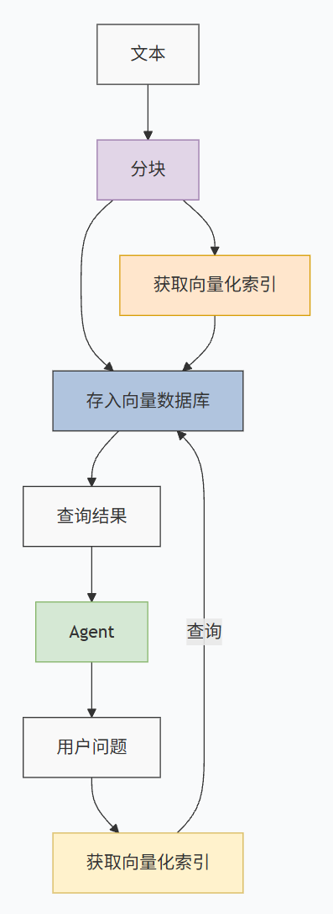

#  RAG 检索增强生成（基于向量的 RAG）

RAG 是一种将 **信息检索** 与 **文本生成** 相结合的技术架构。
它允许大模型在回答问题时，先从外部知识库中检索相关信息，然后基于这些信息生成准确、可靠的回答。

# 架构图

# 向量数据库构建流程

## 一、 分块（Chunking）
*   大模型一次能接收的信息有限，将长文档切分成合适大小的语义单元。

## 二、 向量化（Vectorization）
*   **核心痛点**：计算机不识字，只识数。
*   **目的**：将文字转换为数学表示。
*   **技术做法**：使用嵌入模型（Embedding Model），将文字转化为：
    *   **高维空间坐标**
    *   （通常为512 - 1024维）

## 三、 向量存储（Vector Storage）
*   **核心目的**：让检索像查字典一样快，需要专门的向量数据库支持。
*   **数据库选择指标**：
    *   **亿级数据**：支持海量向量存储。
    *   **毫秒级响应**：提供近实时检索体验。

---
💡 **一句话总结**：整个流程就是把**长文本**按语义**切块** ➡️ 用模型把文字变成**高维数字（向量）** ➡️ 最后存入**专门的向量数据库**以便实现极速检索。

# 分块策略

无论什么策略，一定是语义完整性优先，保证分割后的片段，包含解决问题所需要的知识。

## 按结构/层级切分

分为三个级别：**L1 文档级** ➡️ **L2 段落级** ➡️ **L3 句子级**。

*注：实际逻辑链路中，通常是 **L1 文档 ➡️ L2 段落 ➡️ L3 句子** 的顺序进行下钻。*

---

L1：文档级切分 (Document Level) —— 【粗筛】
*   **作用**：快速粗筛定位。
*   **逻辑**：判断文档的宏观类型（例如：判断是《规格文档》还是《技术说明》）。
*   **场景**：用于宏观方向把控，确定大致的检索范围。

L2：段落级切分 (Paragraph Level) —— 【中筛】
*   **作用**：中筛缩小范围。
*   **逻辑**：在确定文档后，定位到问题对应的具体段落。
*   **场景**：缩小检索的上下文（Context）范围，从而提升检索的**精度**。

L3：句子级切分 (Sentence Level) —— 【精筛】
*   **作用**：精筛并提取核心。
*   **逻辑**：精准提取包含答案的具体句子。
*   **价值**：这是最终给到大模型（LLM）的高质量上下文，在企业知识库场景中，实测可将**召回率提升 22%**。

---

**总结**：这三步构成了一个典型的信息检索漏斗。先找对“书架”（L1），再找对“书页”（L2），最后精准定位到“那一句话”（L3）。

## 语义分割（Semantic Chunking）

不要按固定的字数、标点符号或段落来机械地切分文本，而是让机器去理解文本的“意思”，在“话题发生转变”的地方进行切分。

语义分割的目的就是：保证切出来的每一块，内部的意思都是完整、连贯的。

**基础策略：TextRank 算法**
    这是一种基于图模型的算法（类似 Google 的 PageRank）。
    **原理**：它会把文本拆成一句一句，然后两两比较句子之间的“相似度”，建一个巨大的相似度矩阵。如果相邻的几个句子互相都很相似，说明它们在聊同一个话题，就把它们绑在一起；
    **切分点在哪？**：如果突然出现一个不相关的句子，就说明话题变了，这就应该是一个切分点。

**高级策略：Embedding 模型（向量化）**
    这是目前 RAG 中最主流、效果最好的方法。
    **原理**：利用 Embedding 模型，把每一个句子变成向量。然后计算“前一句”和“后一句”在向量空间里的距离（相似度）。
    **切分点在哪？** 当发现**前后句子的相似度突然暴跌**（也就是话题突变处），说明从这一句开始，意思已经变了，机器就会在这里下刀切分。

**总结**：前面的 L1/L2/L3 是按结构切，而语义分割，是按“内在逻辑和意思” 切。两者在实际工程中通常会**结合使用**，效果最佳。

## 为切分好的 Chunk 添加元数据（Metadata）

对于一个文本块来说，内容本身是正文，而元数据就是描述这个块的附加信息。

### 元数据作用

这大大缩小了检索范围，避免了“答非所问”或检索到过期信息。

*场景：*
1.  **用户输入**：不仅有查询文本的向量（`<query_embedding>`），还附带了你限定的元数据标签，比如 `<2024年> / <金融>`。
2.  **向量数据库**：里面存了很多“财报信息”的 Chunk（文本块）。
3.  **精准过滤**：系统会先根据你给的标签（2024年、金融）进行**过滤**。只挑出符合这两个标签的 Chunk 然后再计算向量相似度。

添加元数据的 3 大核心价值
这是企业在落地 RAG 时必须考虑的三个关键指标：

1.  🛡️ **降低幻觉（信息锁定）**
    通过元数据限制检索范围，让大模型只能基于被锁定的、真实存在的信息回答。
2.  🔒 **权限合规（安全围栏）**
    给敏感文本打上权限标签（如：仅法务部可见）。
3.  🔗 **可追溯性（引用溯源）**
    因为每个 Chunk 都绑定了“文件名”和“页码”。当大模型生成答案后，可以在答案旁附带引用链接。用户点击一下，就能直接跳转到原始 PDF/Word 文档的对应页面。

---

## 💡 分块策略总结

1.  **宏观架构**：使用 L1 -> L2 -> L3 的漏斗模式，从文档粗筛到句子精筛。
2.  **切分技术**：在具体切块时，使用**语义分割（Embedding/TextRank）**，保证切出来的每一块意思都是完整的。
3.  **数据增强**：给切好的块穿上**“元数据”**这件马甲，实现**精准过滤、权限控制、来源溯源**。

可以说，**“好的切分策略 + 丰富的元数据”**，是构建一个能在企业真正落地的高级 RAG 系统的基石。

# 向量化

RAG 系统中最底层、最核心的机制：**把 chunk文本 向量化（Embedding）**。

结合“分块”和“元数据”，这三者构成了 RAG 系统完整的前置处理流程。

---

## 重要性

这是 RAG 流程中“索引（Indexing）”阶段的关键动作，向量化直接决定了 **“检索的准确性”** 和 **“生成的质量”**。

索引层是一座“语义空间的桥梁”。它连接了人类写的原始知识，和机器进行的语义检索。

## 核心动作

文本 → 通过 Embedding Model（嵌入模型） → 输出高维向量。
    

## 余弦相似度（Cosine Similarity）

在向量空间里，每一段文本都是一根从原点射出去的“箭头”。

**余弦相似度，计算的就是这两个“箭头”之间的夹角。**
*   **夹角越小（趋近于0度）**：说明两个箭头指向同一个方向，也就是**意思越相近**（余弦值趋近于1）。
*   **夹角越大（趋近于90度）**：说明箭头垂直，**没有相关性**（余弦值为0）。
*   **夹角极大（趋近于180度）**：说明箭头指反了，**意思完全相反**（余弦值为-1）。

1.  **取值范围：-1 到 1**
    *   **1**：完全匹配。比如“我喜欢吃苹果”和“我非常爱吃苹果”。
    *   **0**：毫无关系。比如“我喜欢吃苹果”和“今天股市大跌”。
    *   **-1**：完全相反。比如“我喜欢吃苹果”和“我极其讨厌苹果”。
2.  **语义即距离**
    *   在 RAG 检索时，计算机就是在计算**用户的问题向量**和**数据库里的文本块向量**之间的余弦值。
    *   余弦值越接近 1（距离越近），说明这个文本块和用户问的问题越相关，系统就会把它揪出来作为参考资料。

为什么不直接算两点之间的直线距离（欧氏距离）？
**因为余弦相似度只看“方向”，不看“长度”。**
*   在文本里，一个长段落和一个短句子，它们的向量“长度”不同。但如果它们探讨的**主题和语义相同**，它们的方向就是一致的。用余弦计算，就能完美避开文本长度（字数多少）带来的干扰。

## 语义权重增强 TF-IDF（词频-逆文档频率）

### 1. TF (Term Frequency) - 词频：看“局部”
如果一个词在一篇文章里反复出现，那它大概率就是这篇文章的重点。
公式：**某个词出现的次数** 除以 **这篇文章的总词数**（除以总词数是为了防止长文章占便宜，长文章里词出现的绝对次数肯定多）。

### 2. IDF (Inverse Document Frequency) - 逆文档频率：看“全局”
物以稀为贵。像“的”、“是”、“在”这种词，在**所有**文章里都出现，那它就毫无区分度，权重应该极低。反之，像“光刻机”、“Transformer”、“X-100型号”这种词，只在**极少部分**特定文章里出现，那它就极具辨识度，权重应该极高。
公式解释：**总文档数** 除以 **包含这个词的文档数**，再取对数。

### 3. TF-IDF = TF × IDF
一个词要想获得**最高**的 TF-IDF 权重，必须是：**在这篇文章里疯狂出现（高 TF），但在别的文章里几乎找不到（高 IDF）。**

---

### 实际企业中的 RAG 方案：

现在主流的架构叫 **混合检索 (Hybrid Search)**。
系统会同时用两种方式找答案：
1.  用 **Embedding** 找出一批“意思相近”的内容。
2.  用 **TF-IDF / BM25** 找出一批“字面精确匹配”的内容。
3.  把两者的结果合并，再给大模型生成答案。

# 💡整个 RAG 流程串起来

1.  **切块（Chunking）**：把几百页的 PDF 文档，按照 L1/L2/L3 或**语义分割**，切成一个个小小的文本块（Chunk）。
2.  **打元数据（Metadata）**：给这些文本块贴上“文件名、年份、权限”等标签。
3.  **向量化（Embedding）**：把切好、贴好标签的文本块，塞进 Embedding 模型，全部变成一串串数字。
4.  **存入数据库**：把这些数字（向量）和标签存进“向量数据库”里。
5.  **检索（Retrieval）**：当用户提问时，用户的问题也会被向量化。系统去数据库里算一下，哪串数字（文本块）和问题的数字最相似（距离最近）**余弦相似度**，就把对应原文揪出来，给大模型去生成答案。
