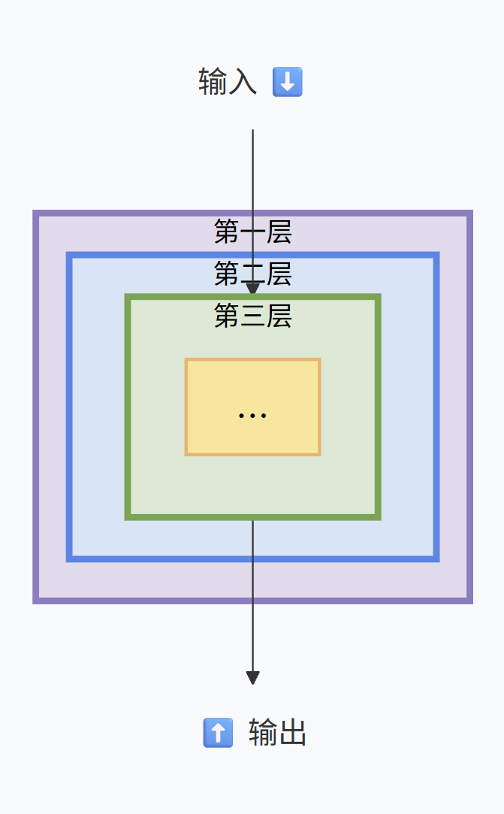
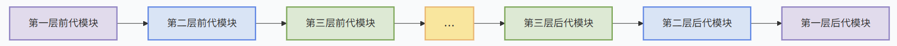
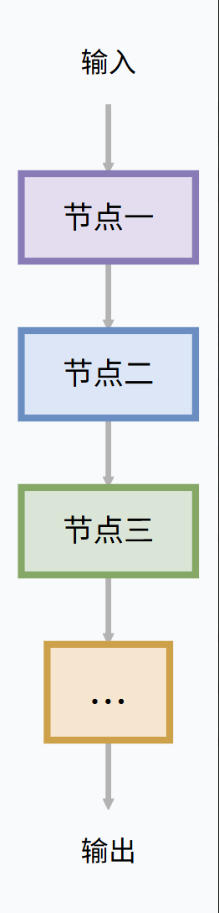

# 中间件作用

它让你能在不修改 Agent 核心代码的情况下，像“插件”一样向它的运行流程中注入日志、监控、安全、上下文管理等通用能力。


# 结构

两种结构

## 洋葱式嵌套结构




执行方式： “穿透-反弹”。输入数据从最外层开始，穿过第一层、第二层，到达最内层的核心逻辑；核心逻辑处理完后，结果再原路返回，经过第二层、第一层的处理，最后输出。

特点： 环绕式执行（Wrap-around）。每一层都有两次干预机会：一次在核心逻辑执行前（处理输入），一次在执行后（处理输出）。

典型应用： 也就是图二介绍的中间件（Middleware）。适合处理“横切关注点”，比如：日志记录（记录开始和结束）、性能监控（计算耗时）、全局鉴权、上下文注入等。只要你想在某个步骤前后加通用逻辑，就用这种。


## 串行结构



执行方式： “单向传递”。输入从顶部进入节点一，节点一的输出直接作为节点二的输入，节点二处理完给节点三，最后从底部输出。

特点： 顺序执行（Sequential）。数据单向流动，不回头。每个节点通常只负责一个独立的具体功能，不关心也不需要知道前后节点做了什么。

典型应用： 也就是 Agent 的工作流（Workflow）。适合构建任务处理步骤，比如：一个节点负责意图识别，下一个节点负责检索知识库，再下一个节点负责生成最终回答；或者图中的 ReAct 模式（思考 -> 行动 -> 观察）。


## 两者结合

洋葱是用来“包装”串行节点的。可以把“流水线”整个包裹在“洋葱”核心里。当流水线中的每个节点执行时，都会触发外层洋葱中间件的拦截（比如记录每个节点的耗时），两者是互补协作的关系


# 中间件钩子（Hooks）方法表

AgentScope 选择了一条与传统框架不同的路：不通过继承 Agent 类来扩展能力，而是将所有定制逻辑（如 RAG、链路追踪、预算控制、长期记忆）外置为**中间件**，挂载在智能体生命周期的关键点上。

*   **Onion（洋葱式）**：像洋葱一样层层包裹。你可以在核心逻辑执行**前**和**后**插入代码，甚至能观察或修改中间的事件流。
*   **Transformer（变换式）**：像流水线。多个中间件首尾相连，前一个的输出会作为后一个的输入，适合对某个对象进行连续加工。
*   **Tool source（工具来源）**：它不在主执行路径上，更像一个“工具仓库”，用于声明中间件能提供哪些额外的工具。

---

### 🧅 五个洋葱钩子（Onion）：包裹执行流程

这五个钩子嵌套在智能体的运行循环中，从外到内层层包裹。

**1. `on_reply`：包裹一次完整的回复流程**
*   **位置与包裹**：位于最外层。它包裹了从接收到用户请求，到最终生成回复的**全部过程**，包含其中所有的 ReAct 推理轮次、工具调用和最终输出。
*   **典型用途**：适合做**全局性的操作**，比如在请求开始和结束时记录完整耗时、统计总 Token 消耗，或者在整个回复流程前后进行权限校验。

**2. `on_compress_context`：包裹上下文压缩逻辑**
*   **位置与包裹**：位于每轮 ReAct 循环的**顶部**，在推理步骤之前触发。它包裹了 `Agent.compress_context()` 方法，由智能体自身决定是否要压缩上下文以节省 Token。
*   **典型用途**：用于实现**上下文管理策略**。例如，你可以自定义压缩算法，或者在压缩前后注入钩子，来监控或干预上下文的增长。

**3. `on_reasoning`：包裹一轮 ReAct 的推理步骤**
*   **位置与包裹**：包裹单轮 ReAct 循环中的**推理阶段**，具体包括“输入组装 → 模型调用 → 流式解码”这一完整链路。
*   **典型用途**：这是进行**推理过程监控**的核心位置。例如，实时审计模型输出的流式文本（敏感词检测），或在输入组装阶段对提示词进行改写。

**4. `on_model_call`：包裹一次底层模型 API 调用**
*   **位置与包裹**：位于最内层，直接包裹**一次原始的 `ChatModel` API 调用**，是离模型最近的一层。
*   **典型用途**：适合做**最底层的模型交互控制**，比如精确统计每次 API 调用的 Token 数量、记录原始请求和响应日志，或在调用前动态修改模型参数（如 temperature）。

**5. `on_acting`：包裹一次工具调用的执行**
*   **位置与包裹**：包裹**单次工具调用的执行**过程。需要注意的是，它目前只包裹智能体**内部**的工具执行，通过外部方式（如外部执行）调用的工具不会触发此钩子。
*   **典型用途**：是实现**人机协同（HITL）** 的关键位置。例如，在执行敏感工具（如发送邮件、执行代码）前，通过 `on_acting` 钩子暂停流程，等待人工审批后再继续。

---

### 🔧 一个变换器钩子（Transformer）：加工字符串

**`on_system_prompt`：在每次组装 System Prompt 时触发**
*   **工作方式**：它采用**流水线**模式。当智能体需要组装系统提示词时，多个中间件会依次执行，**后一个中间件接收前一个中间件的输出**，并对其进行再加工。
*   **嵌套位置**：它**嵌入在 `on_reasoning` 内部**，因为系统提示词正是在推理步骤的“输入组装”阶段被构建的。
*   **典型用途**：适合进行**动态的提示词增强**。例如，根据用户查询实时从知识库检索信息，并将检索结果动态注入到系统提示词中，实现 RAG 能力。

---

### 🛠️ 一个工具来源钩子（Tool source）：声明工具

**`list_tools`：返回中间件贡献的工具列表**
*   **工作方式**：它**不在运行时路径上**被自动调用。`Agent.__init__` 不会自动执行它。你需要**显式地**从中间件中收集工具，并手动传入 `toolkit` 中。
*   **典型用途**：用于**模块化地扩展智能体能力**。你可以编写一个中间件，通过 `list_tools` 声明它提供了 `search_knowledge`、`calculator` 等工具，然后在构建 Agent 时将这些工具合并进去，让智能体自主调用。

### 💡 补充：执行顺序与嵌套关系

这些钩子在运行时并非孤立的，而是有着严格的嵌套顺序。一个完整的 `on_reply` 内部可能包含多轮 ReAct 循环，每一轮的逻辑大致如下：

```
on_reply (最外层)
└── ReAct 循环 (每一轮)
    ├── on_compress_context (上下文压缩判定)
    └── on_reasoning (推理步骤)
        ├── on_system_prompt (组装系统提示词)
        ├── on_model_call (模型 API 调用)
        └── on_acting (工具调用，每调用一个工具触发一次)
```

理解这个嵌套结构，有助于你在正确的位置注入逻辑，实现对智能体行为的精准控制。


# 应用 Demo

```python
# ==========================================
# 1. 依赖库导入
# ==========================================
from agentscope.message import Msg, TextBlock  # 导入消息类和文本块类，用于构造对话内容
from agentscope.model import OpenAIChatModel   # 导入 OpenAI 格式的模型类
from agentscope.agent import Agent, ContextConfig  # 导入 Agent 核心类和上下文配置类
import asyncio  # 导入异步IO库，用于处理流式输出和并发
from agentscope.tool import Toolkit, Read  # 导入工具包和内置的 Read 读取工具
from agentscope.event import UserConfirmResultEvent  # 导入用户确认结果事件类
from agentscope.credential import OpenAICredential  # 导入 OpenAI 格式的凭证类
from agentscope.middleware import MiddlewareBase  # 导入中间件基类，用于自定义钩子
from agentscope.event import EventType, TextBlockDeltaEvent, RequireUserConfirmEvent  # 导入事件类型、文本块增量事件和请求用户确认事件 (RequireUserConfirmEvent 为图片截断补全)
import json  # 导入 json 库，用于序列化 Agent 状态
# from agentscope.tool import Toolkit, Read  # (原图此处有重复导入，已忽略)
from agentscope.message import ConfirmResult  # (根据第五张图推断补全) 导入工具调用确认结果类

# ==========================================
# 2. 自定义中间件 (Middleware)
# 拦截 Agent 运行周期的各个阶段并注入自定义逻辑
# ==========================================
class MyMiddleware(MiddlewareBase):
    def __init__(self, file_path=None, *args, **kwargs):  # 初始化方法，接收保存状态的文件路径
        super().__init__(*args, **kwargs)  # 调用父类的初始化方法
        self.file_path = file_path  # 保存文件路径到实例属性中

    async def on_reply(self, agent, input_kwargs, next_handler):  # 钩子：在 Agent 回复阶段触发
        async for event in next_handler(**input_kwargs):  # 调用下一个处理链，获取事件流
            yield event  # 将事件原样传递给下游/前端
        if self.file_path is not None:  # 如果配置了文件路径
            saved_state_dict = agent.state.model_dump(mode="json")  # 将 Agent 当前状态导出为 JSON 兼容的字典
            with open(self.file_path, "w") as f:  # 以写入模式打开指定文件
                json.dump(saved_state_dict, f)  # 将状态字典序列化并保存到文件中 (实现状态持久化)

    async def on_reasoning(self, agent, input_kwargs, next_handler):  # 钩子：在 Agent 推理(Thinking)阶段触发
        f = "💗 " + "+" * 60  # 定义一段替换的特定文本格式 (一颗心加60个加号)
        async for event in next_handler(**input_kwargs):  # 获取推理阶段的事件流
            if hasattr(event, "type") and event.type in [EventType.THINKING]:  # 如果事件包含类型且是“思考”类型
                # 将原本的思考事件替换为指定文本的增量事件 (block_type="text" 为推断补全)
                event = TextBlockDeltaEvent(reply_id=event.reply_id, block_type="text", text=f)  
            yield event  # 返回处理后的事件

    async def on_model_call(self, agent, input_kwargs, next_handler):  # 钩子：在调用大模型阶段触发
        original_stream = await next_handler(**input_kwargs)  # 执行下一个处理链，获取原始的模型输出流
        async def wrapped_stream():  # 定义一个内部函数来包装数据流
            async for chunk in original_stream:  # 遍历原始数据流的每一个数据块
                yield chunk  # 将数据块逐个向外抛出
        return wrapped_stream()  # 返回包装后的异步生成器

    async def on_acting(self, agent, input_kwargs, next_handler):  # 钩子：在工具调用(Acting)阶段触发
        print("\n工具开始调用！！！！！！！！！！！！！！！！！！！！！！！！！！！！！！！！！！！！！！！！")  # 打印工具调用前的提示信息
        async for event in next_handler(**input_kwargs):  # 执行下一个处理链，执行工具调用并产生事件
            yield event  # 向外抛出事件
        print("\n工具结束调用！！！！！！！！！！！！！！！！！！！！！！！！！！！！！！！！！！！！！！！！")  # 打印工具调用结束后的提示信息

    async def on_system_prompt(self, agent, input_kwargs):  # 钩子：在生成系统提示词阶段触发
        new_prompt = input_kwargs + " 注意你的名字叫AAG。"  # 在原有系统提示词后追加自定义的指令
        return new_prompt  # 返回修改后的系统提示词

# ==========================================
# 3. 模型与凭证配置
# ==========================================
credential = OpenAICredential(  # 实例化凭证
    api_key="xxx",  
    base_url="xxx"  
)

model = OpenAIChatModel(  # 实例化模型类
    model="qwen3.7-plus",  # 指定使用的模型名称
    credential=credential,  # 传入上面定义的凭证
    stream=True  # 开启流式输出模式
)

# ==========================================
# 4. Agent 实例化配置
# ==========================================
agent = Agent(  # 实例化 Agent
    name="My_Agent",  # Agent 的名称
    model=model,  # 传入配置好的模型
    system_prompt="你是一个Agent",  # 基础的系统提示词
    # 这是传给 MyMiddleware 初始化方法（__init__）的参数，对应代码中的 file_path
    # 每次 Agent 回答完一轮对话后，它会把当前的内部状态（agent.state，里面通常包含了完整的对话历史、记忆等）转换成 JSON 格式，并覆盖写入到 ./my_agent.json 这个文件里。
    middlewares=[MyMiddleware("./my_agent.json")],  # 挂载自定义的中间件，并指定状态保存路径
    context_config=ContextConfig(  # 配置上下文管理参数
        trigger_ratio=0.8,  # 触发上下文压缩的阈值 (上下文使用率达到 80% 时触发)
        reserve_ratio=0.1,  # 压缩后保留的历史信息比例 (保留 10%)
        tool_result_limit=3000  # 工具返回结果的最大长度限制
    ),
    toolkit=Toolkit([Read()])  # 挂载工具包，这里挂载了内置的 Read 工具
)

# ==========================================
# 5. 交互主循环与流式输出
# ==========================================
async def chat_with_agent_stream():  # 定义异步主函数
    confirm_event = None  # 初始化确认事件变量为 None
    while True:  # 开启无限循环，保持对话
        if confirm_event is None:  # 如果当前没有需要确认的工具事件 (正常用户输入阶段)
            user_input = input("user>>>")  # 等待用户从控制台输入
            # 将用户输入封装成 Msg 对象 (text=user_input 为根据图片上下文推断补全)
            user_msg = Msg(role="user", content=[TextBlock(type="text", text=user_input)])  
        else:  # 如果当前有需要确认的工具事件 (用户对工具调用的确认阶段)
            user_msg = confirm_event  # 将确认事件作为用户消息发给 Agent
            confirm_event = None  # 重置确认事件状态
        
        print("agent>>>")  # 打印 Agent 响应提示符
        async for event in agent.reply_stream(user_msg):  # 调用 Agent 的流式回复方法，遍历返回的事件流
            if isinstance(event, RequireUserConfirmEvent):  # 如果事件是要求用户确认工具调用
                confirm_results = []  # 初始化确认结果列表
                for tc in event.tool_calls:  # 遍历需要调用的每一个工具
                    # 弹出交互框询问用户是否同意，根据用户输入(y/n)设置 confirmed 状态 (tc.name 为推断补全)
                    is_confirmed = True if input(f"\nsystem>>>是否同意调用{tc.name} (y/n): ") == "y" else False
                    confirm_results.append(ConfirmResult(  # 构造确认结果对象
                        confirmed=is_confirmed,  # 传入用户的确认结果
                        tool_call=tc,  # 传入对应的工具调用信息
                        rules=tc.suggested_rules,  # 传入工具建议的规则
                    ))
                confirm_event = UserConfirmResultEvent(  # 将所有确认结果封装成一个确认结果事件
                    reply_id=event.reply_id,  # 保持相同的回复 ID
                    confirm_results=confirm_results,  # 传入确认结果列表
                )
            elif hasattr(event, "delta"):  # 如果事件包含 delta 属性 (流式文本增量)
                print(event.delta, end="", flush=True)  # 实时打印文本内容，不换行且强制刷新缓冲区
        print("\n")  # 一次对话结束后打印换行

if __name__ == '__main__':  # 程序入口判断
    asyncio.run(chat_with_agent_stream())  # 运行异步主函数
```