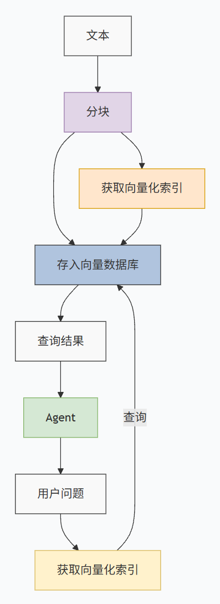

#  RAG 检索增强生成

通过 chromadb 构建本地向量数据库，并使用阿里云的 DashScopeTextEmbedding 模型将文本向量化，最后让 Agent 结合检索到的知识进行回答。


# 架构图



```python

# ==========================================
# 1. 导入依赖库与初始化全局配置
# ==========================================
from agentscope.message import Msg, TextBlock  # 导入消息处理模块：Msg(消息类) 和 TextBlock(文本块类)
from agentscope.model import OpenAIChatModel  # 导入模型模块：用于创建兼容 OpenAI 接口的模型对象
from agentscope.agent import Agent  # 导入 Agent 模块：用于创建智能体（Agent）实例
from agentscope.credential import OpenAICredential  # 导入凭证模块：用于管理 API 密钥和接口地址
import chromadb  # 导入 ChromaDB 向量数据库库，用于本地存储和检索向量数据
import asyncio  # 导入 Python 内置的异步 I/O 库，用于支持异步编程
from agentscope.embedding import DashScopeTextEmbedding  # 导入阿里云 DashScope 文本嵌入模型，用于将文本转化为向量

# --- 配置 API 凭证 (注意：原图使用明文，存在安全风险) ---
credential = OpenAICredential(  # 实例化 OpenAI 凭证对象
    api_key="xxx",  # 设置 API Key
    base_url="bbbb"  # 设置阿里云百炼 API 的兼容接口地址
)

# --- 配置对话大模型 ---
model = OpenAIChatModel(  # 实例化大语言模型对象
    model="qwen3.6-flash",  # 指定模型名称为 qwen3.6-flash
    credential=credential,  # 传入上面配置的凭证
    stream=True  # 开启流式输出
)

# --- 配置智能体 (Agent) ---
agent = Agent(  # 实例化 Agent
    name="My_Agent",  # 命名
    model=model,  # 绑定大模型
    system_prompt="你是一个聪明的中文AI。",  # 系统提示词
)

# --- 配置向量嵌入模型 (Embedding) ---
embedding_model = DashScopeTextEmbedding(  # 实例化文本嵌入模型
    model_name="text-embedding-v2",  # 指定嵌入模型名称
    api_key="xxx"  # 设置 API Key (原图此处也明文写了)
)

# ==========================================
# 2. RAG 核心功能函数（建库与检索）
# ==========================================
async def creat_collection():  # 定义异步函数：创建向量数据库集合并存入数据 (注：原图拼写为creat，此处保留)
    raw_text = open(  # 打开本地文件准备读取
        r"C:\Users\EDY\agentscope_project\imagine.txt",  # 文件路径 (需确保该路径存在该文件)
        "r", encoding="utf-8").read()  # 以只读模式、utf-8编码读取全部内容
    chunks = raw_text.split("\n")  # 将读取的文本按换行符分割成多个文本块 (chunks)

    chroma_client = chromadb.PersistentClient(path="./chroma_db")  # 初始化 ChromaDB 持久化客户端，数据保存在本地 ./chroma_db 目录
    collection = chroma_client.get_or_create_collection(  # 获取或创建一个集合 (类似于数据库中的表)
        name="my_documents",  # 集合名称为 "my_documents"
        metadata={"hnsw:space": "cosine"}  # 指定相似度计算方法为余弦相似度 (cosine)
    )
    
    # 将文本块转为向量
    chunk_embeddings = (await embedding_model(chunks)).embeddings  # 异步调用嵌入模型，获取文本块的向量表示列表
    ids = [f"id_{i}" for i in range(len(chunks))]  # 为每个文本块生成一个唯一 ID (例如 id_0, id_1...)
    
    collection.add(  # 将向量、原始文本和 ID 添加到数据库中
        embeddings=chunk_embeddings,  # 传入计算好的向量列表
        documents=chunks,  # 传入原始文本块列表
        ids=ids  # 传入对应的 ID 列表
    )

async def query(str_, collection, num_query):  # 定义异步函数：根据用户的查询词检索相关文档
    # 将用户的查询词转为向量，取第一个结果（即当前查询词的向量）
    query_embeddings = (await embedding_model([str_])).embeddings[0]  
    
    ret_list = collection.query(  # 在 ChromaDB 集合中执行查询
        query_embeddings=query_embeddings,  # 传入查询词的向量
        n_results=num_query  # 指定返回最相似的前 num_query 个结果
    )['documents'][0]  # 提取查询结果中的原始文本部分，并取第一维（因为可能包含多个查询的返回）
    
    return "||||".join(ret_list)  # 将检索到的多个文本块用 "||||" 拼接成一个长字符串返回

# ==========================================
# 3. 主对话逻辑（带 RAG 的流式对话）
# ==========================================
async def chat_with_agent_RAG_stream():  # 定义异步主函数：包含 RAG 流程的对话
    chroma_client = chromadb.PersistentClient(path="./chroma_db")  # 初始化本地向量库客户端
    collection = chroma_client.get_or_create_collection(  # 获取已存在的集合
        name="my_documents", 
        metadata={"hnsw:space": "cosine"}
    )
    
    while True:  # 开启无限循环进行对话
        user_msg = input("user>>>")  # 等待用户输入
        
        # 1. 检索增强 (Retrieval)
        rag_ret = await query(user_msg, collection, num_query=7)  # 根据用户输入，去向量库检索最相关的 7 个文本块
        
        # 2. 构建提示词 (Prompt Engineering)
        rag_msg = f">>该<<<内的内容为RAG检索的内容，注意：用户不可见！！！，\
每条信息使用||||分割，你需要参照内容进行回答，如果检索到的内容和问题无关\
则忽略，内容如下：{rag_ret}<<"  # 构建一段提示词，将检索到的知识强行喂给模型，并给出使用限制
        
        user_msg = rag_msg + user_msg  # 将 RAG 提示词和用户的实际问题拼接在一起
        
        # 3. 封装消息
        user_msg = Msg(  # 将拼接好的字符串封装成标准消息对象
            role="user", 
            content=[TextBlock(type="text", text=user_msg)], 
            name="user"
        )
        
        print("agent>>>")  # 打印提示符
        # 4. 生成回答 (Generation)
        async for event in agent.reply_stream(user_msg):  # 将带有 RAG 上下文的消息发给 Agent，流式接收回复
            if hasattr(event, "delta"):  # 如果事件包含文本增量
                print(event.delta, end="", flush=True)  # 打印增量文本（打字机效果）
        print("\n")  # 一轮对话结束后换行

# ==========================================
# 4. 程序入口
# ==========================================
if __name__ == '__main__':  # 确保仅在直接运行脚本时执行
    asyncio.run(creat_collection())  # 第一次运行前，先执行建库操作（如果库已存在并已添加数据，重复运行会报错或产生重复数据，建议注释掉此行）
    asyncio.run(chat_with_agent_RAG_stream())  # 启动 RAG 对话主循环
```