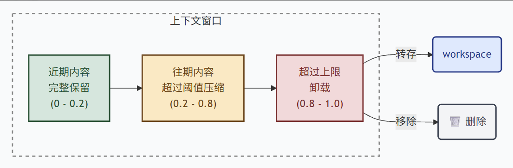

# 上下文管理

因为所有大模型的“内存”（上下文窗口）都是有限的。如果不做管理，对话一长，模型就会报错（Context Length Exceeded）或者因为要处理的数据太多而变得极慢且昂贵。这张图展示了一种“平衡记忆”的策略：保近期、压中期、弃远期（类似人类的记忆机制）。

# 机制图




# 示例-自动触发

```python
from agentscope.agent import Agent, ContextConfig  # 导入 Agent 核心类，以及用于管理上下文窗口的配置类
from agentscope.workspace import LocalWorkspace  # 导入本地工作空间类
from agentscope.model import OpenAIChatModel  # 导入大语言模型类
from agentscope.credential import OpenAICredential  # 导入 API 凭证配置类
from agentscope.tool import Toolkit 

# ==========================================
# 1. 初始化工作区与工具
# ==========================================
workspace = LocalWorkspace(workdir="./my_agent_workspace")  # 实例化本地工作空间，指定运行目录
await workspace.initialize()  # 异步初始化工作空间（创建文件夹、环境检测等）
tools = await workspace.list_tools()  # 获取工作空间默认提供的工具列表

# ==========================================
# 2. 配置上下文窗口参数 (核心部分)
# ==========================================
contextconfig = ContextConfig(  # 实例化上下文配置对象
    trigger_ratio=0.8,  # 触发压缩/清理的阈值比例。当对话历史占用的 Token 数达到模型最大上下文长度的 80% 时，触发历史记录的管理机制
    reserve_ratio=0.1,  # 保留比例。在执行压缩或清理时，保留最近 10% 的对话内容或 Token 空间，确保近期的对话记忆连贯
    tool_result_limit=3000  # 工具结果长度限制。限制单次工具调用返回的结果最大为 3000 个字符（或 Token）。如果工具返回的内容过长，会被截断，防止单次工具调用撑爆上下文
)

# ==========================================
# 3. 配置大模型
# ==========================================
model = OpenAIChatModel(  # 实例化大语言模型
    credential=OpenAICredential(  # 传入 API 凭证
        api_key="xxx",  
        base_url="xxx", 
    ),
    model="qwen3.6-flash",
)

# ==========================================
# 4. 实例化 Agent 并挂载上下文配置
# ==========================================
agent = Agent(  # 实例化智能体
    name="my_assistant",  # 智能体名称
    system_prompt="你是一个有帮助的助手。",  # 系统提示词
    model=model,  # 绑定大模型
    toolkit=Toolkit(tools=tools),  # 绑定工具集
    offloader=workspace,  # 绑定工作空间执行器
    context_config=contextconfig,  # 关键：将配置好的上下文管理策略传入 Agent 状态中
)
```

# 示例-手动调用

手动触发 LLM 智能体（Agent）上下文压缩（Context Compression） 

```python
await agent.compress_context(
    context_config=ContextConfig(
        trigger_ratio=0.5,
        reserve_ratio=0.1,
    )
)
```